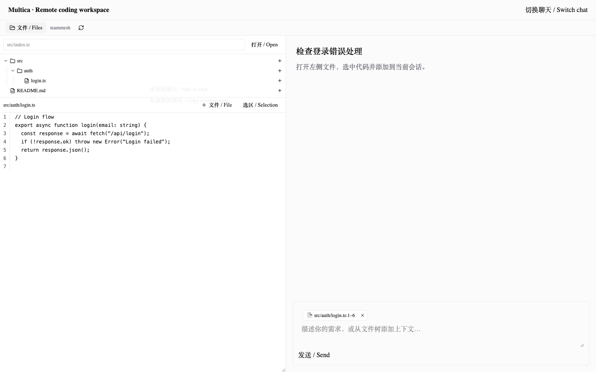
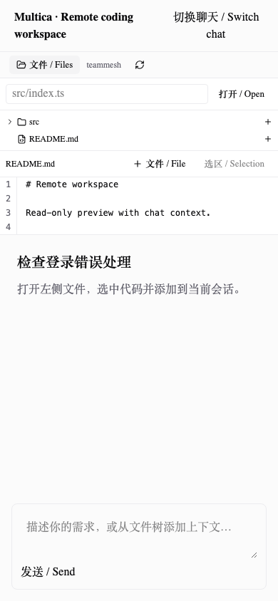

# Remote chat workspace (first release)

Read-only remote code browsing in the full Chat page. The browser never supplies
an absolute root. The executor records its actual `env.WorkDir` for a chat, and
rebinds after successful local-worktree delivery to `DurableWorkDir`. A random
binding ID changes when the path, filesystem identity, runtime or workspace
changes. References from a different binding are rejected, not silently remapped.

## User workflow

1. Upgrade **server, Web and daemon together**. The daemon advertises
   `remote-workspace-v1`; older/offline clients return an actionable error.
2. Use a conversation you created, with a private Agent you own on a runtime you
   own. Run one turn so the daemon has prepared and registered its work directory.
3. Open **Files** in the full Chat page. Expand directories, enter a relative file
   path, or open a file for highlighted read-only preview with line numbers.
4. Right-click a file/directory → **Add to chat**. The plus button is also available
   for touch/keyboard access. Select code → **Selection** (or context menu).
5. Review/remove the chips above the composer and send a normal prompt. Failed
   sends preserve chips. Switching accounts/workspaces/chats isolates drafts.

Directory references specify a scope; they **do not recursively attach files**.
File references resolve to bounded send-time snapshots; preview/selection
references include SHA-256 and fail if the file changed. The server resolves the
references before enqueue, then persists the verified JSON snapshot in the normal
message body. This deliberately reuses provider-neutral prompt/history/draft
restoration paths: it does not depend on one CLI's proprietary attachment format.
The returned authoritative message content is used in optimistic caches too.

Source is treated as reference data, not trusted instructions. Snapshots can be
older than execution if the turn queues. The prompt explicitly asks the Agent to
verify the current working directory/revision before editing. This is context
selection, **not a filesystem sandbox for the Agent**.

## Access and resource boundaries

- Current workspace/chat ACL plus conversation creator + private Agent owner +
  machine owner. Recheck after remote I/O. Reassigned runtimes fail closed.
- Request/response uses the existing authenticated daemon control connection,
  independent of Agent task slots. Replies must come from the exact connection.
- Reject ambiguous duplicate daemon connections; no arbitrary remote selection.
- 8-second API timeout, 64 hub requests, 8 requests per connection, 4 daemon file
  workers, 32 KiB request limit and 2 MiB frame limit.
- Open through Go `os.Root`. Pin directory handles, compare filesystem identities,
  disallow symlink components, and use nonblocking/no-follow Unix file opens.
  Root replacement, traversal, alternate Windows streams, device/special files,
  invalid UTF-8 and binary content are refused.
- Block common sensitive paths (`.env*`, `.ssh`, `.aws`, `.gnupg`, `.npmrc`, `.netrc`,
  private-key extensions/names), `.git` and `node_modules`. This is a conservative
  convenience filter, **not a general secret detector**. Files with other names
  may still contain secrets; users must review their selected context.
- 128 KiB per text preview, 12 references and 256 KiB combined source context;
  200 entries/page, 10,000 entries/directory. No recursive crawl/indexing.
- No file contents in local/session storage; preview query cache is removed on
  leaving the chat. Reference drafts are memory-only and do not survive reload.
  Sending intentionally stores selected source in normal chat history; later
  sharing an Agent can expose that history under the project's existing ACL.
- Directory/open-file refresh every 5 seconds while visible, plus manual refresh.
  No background watcher daemon or third-party file upload service.

## Current limitations / rollout gates

- Full Chat page only; floating chat retains its existing behavior.
- Workspaces become available **after the first run prepares them**. After daemon
  restart or metadata-cache eviction (512 chat roots), run another turn. This is
  safer than reconstructing authority from an arbitrary stored path.
- Shared Agents/other owners are intentionally unsupported until explicit disk
  grants and transcript-sharing policy exist.
- Single API node, or deployment-level routing to the daemon's API node. There is
  **no cross-node Redis RPC forwarding**; do not enable randomly load-balanced
  file requests and expect them to work.
- Read-only UTF-8 text. No save/delete/terminal, binary/image preview, Git diff,
  recursive search, `@file` picker or first-turn workspace provisioning.
- Source snapshots are currently visible in message history as reference JSON,
  rather than a dedicated collapsible persisted-context component.
- Windows is cross-compiled, not runtime-tested; macOS filesystem tests do not
  establish Windows junction/UNC behavior. Live Agent/provider and database-backed
  deployment acceptance remain necessary before broad rollout.

## Verification

```sh
# Go 1.26.6+, Node >=22 and pnpm; creates an ignored, isolated Web staging tree.
./scripts/remote-workspace-test.sh
./scripts/remote-workspace-browser-test.sh
```

`REMOTE_WORKSPACE_WEB_STAGE` selects a reusable staging directory.
`PLAYWRIGHT_EXECUTABLE_PATH` optionally selects an installed Chromium binary.
No upstream submodule source is modified.

Verified during development:

- Real WebSocket → daemon → temporary filesystem → response integration, including
  reference snapshots; 128 KiB response transport regression.
- Go race-enabled suites for traversal/symlinks, root replacement, ownership scope,
  binding changes, stale revisions, ranges, binary/large files, pagination, limits,
  timeout cleanup and forged connection responses.
- Pure ownership policy tests run separately because upstream handler `TestMain`
  exits successfully without running tests when PostgreSQL is unavailable.
- Server and CLI test binaries compile. Frontend core/views TypeScript checks pass.
- 101 UI/chat tests and 126 API tests pass (existing regression suites included).
- Chromium browser smoke: expansion, right-click, preview, DOM selection, chips,
  mock send, session switching and mobile layout. **Transport is a local fixture**,
  not a production database/Agent integration. Screenshots below show that fixture.

Not verified: a live PostgreSQL-backed authenticated browser→API→real provider run,
Linux/Windows runtime behavior, multi-node deployments and production load.

## Screenshots (isolated UI fixture)




