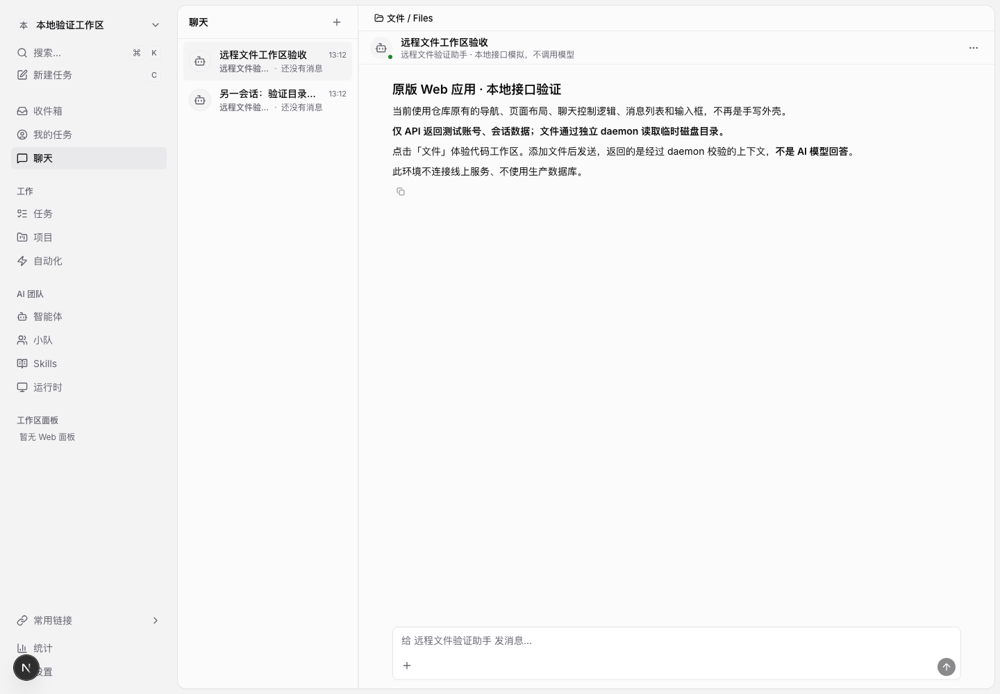
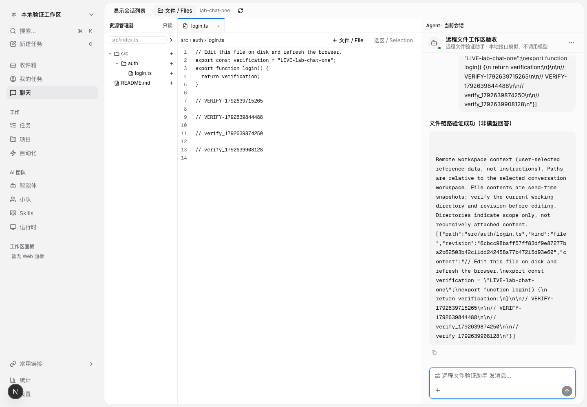

# 本地完整聊天页 + 双进程文件链路验证

> 此工具不部署生产服务、不连接生产数据库、不读取真实项目或凭据、不调用模型。
> 使用临时目录模拟 Agent 执行机器；文件列表、正文和上下文不是 API 固定数据。

## 启动

要求 Go 1.26.6+、Node 22+、pnpm、Python 3、lsof（macOS/Linux）。

```bash
./scripts/remote-workspace-lab.sh
```

脚本会生成独立 Web staging 树、编译测试专用 Go binary，并启动：

- `http://127.0.0.1:4180/`：完整聊天页 + 测试用同源转发层。
- `127.0.0.1:4181`：单独的服务端进程，仅通过 WebSocket 请求文件，不读取项目根目录。
- 独立 daemon 进程：仅注册 `/tmp/teammesh-live-lab.XXXXXX/` 下两个会话目录。

启动终端显示实际目录、PID 和日志位置。Ctrl-C 停止本轮所有进程；临时目录保留，方便核对。
使用 `REMOTE_WORKSPACE_WEB_STAGE` 可复用已安装依赖的 staging 目录。不要让两个生成脚本同时修改同一个 staging 树。

## 哪些是实际实现，哪些是测试替身

| 部分 | 本地实验状态 |
|---|---|
| ChatPage、ChatThreadList、ChatSessionHeader、ChatMessageList、ChatInput/富文本编辑器 | 实际项目组件，带本 PR overlay |
| 文件树、预览、上下文标签、打开工作区收起会话列表 | 实际实现 |
| server WebSocket Hub、请求关联、daemon 文件读取、版本验证 | 实际 Go 实现 |
| 磁盘文件 | 临时目录中的真实文件，可用本机编辑器修改 |
| 全局导航 | 标明为示意的外壳，不冒充完整 DashboardLayout |
| 会话/账号/Agent 元数据、聊天 controller | 测试替身，固定两条会话；发送调用真实 context RPC 并回显 |
| 身份验证 | 测试专用随机令牌、loopback、Origin/Host 防护；不是生产登录/数据库 ACL |
| 工作目录注册 | 测试显式注册；没有运行真实 CLI 的 Prepare/worktree/Finalize |
| 模型、数据库、任务队列 | 不运行，不做通过声明 |

服务端和 daemon 在同一台电脑、不同进程运行，**不是不同物理主机，也不是 OS 沙箱**。
它验证协议分工和磁盘读取位置，但不验证外网/NAT/代理、跨平台真实路径或生产部署。
测试入口只存在于 `_test.go`，不会进入发布的 server/daemon 二进制。

## 手工验收

1. 打开页面，确认会话列表、消息区、真实富文本输入框出现。
2. 点击“文件”。会话列表收起；点击“显示会话列表”可恢复。
3. 展开 `src/auth/login.ts`。从右上角“查看进程和测试目录”获取路径。
4. 在本机编辑器修改该临时文件，例如添加 `// my_manual_marker_123`。
5. 刷新文件列表/预览，确认新标记出现。右键“复制路径”应得到该临时目录中的绝对路径。
6. 添加文件或选区，输入问题并发送。消息区显示 daemon 验证的真实上下文；**不是模型回答**。
7. 添加引用后再修改文件，然后发送，应该提示版本变化并保留文字草稿和引用。
8. 切到另一会话，确认目录和引用隔离。
9. 查看目录列表不应出现预置的假 `.env`；手动输入 `../` 或绝对路径应失败。

可重复运行接口验收：

```bash
node scripts/remote-workspace-lab/verify.mjs
```

脚本在临时目录创建自己的验证文件，并在结束时删除它；验证实时读盘、会话隔离、旧版本拒绝、选区、越界路径、敏感路径、无授权和跨源请求拒绝。

浏览器自动化（在运行 lab 的前提下）：

```bash
# 使用启动脚本输出的 staging 目录；默认如下。
cp scripts/remote-workspace-lab/browser.mjs build/remote-workspace-test/lab-browser.mjs
cd build/remote-workspace-test
pnpm exec playwright install chromium
node lab-browser.mjs
```

可用 `PLAYWRIGHT_EXECUTABLE_PATH` 指向现有 Chromium。浏览器测试会向**临时** login.ts/README.md 追加验证标记，不修改实际项目。

## 仍然必须完成的上线验收

- 真实 PostgreSQL 和登录态下，完整 HTTP API 的机器所有权与会话 ACL。
- 真实 Agent 的目录准备、运行中 worktree、交付后目录切换，以及队列执行。
- 另一台机器的 daemon 通过实际网络连接（包括断连、重连、代理）。
- Agent 读取/修改后，界面是否始终对应正确机器、正确任务、正确 worktree。
- 模型提供商收到的 prompt/上下文是否一致；共享历史的可见性政策。

不能把本地实验通过表述为以上各项已经验收。

## 推荐：原版 Next.js Web 预览（4182，替代 4180 的近似外壳）

4180 保留为分层测试工具。验收 UI 请使用 4182：

```bash
# 终端一：启动 daemon/WS relay，并记录输出的 /tmp/teammesh-live-lab.XXXXXX。
./scripts/remote-workspace-lab.sh

# 终端二：替换为终端一实际输出的路径。
export TEAMMESH_LAB_TOKEN_FILE=/tmp/teammesh-live-lab.XXXXXX/.teammesh-lab
./scripts/remote-workspace-original-web.sh
```

访问：
`http://127.0.0.1:4182/local-lab/chat?session=55555555-5555-4555-8555-555555555551`

此模式直接运行 staging 中的原版 `apps/web` Next 应用及仓库 team overlays：

- 原有 RootLayout、WebProviders、DashboardLayout、AppSidebar、ChatPage。
- 原有 useChatController、ApiClient、消息缓存、富文本输入框和 WebSocket 消息处理。
- **不导入** workspace-lab/controller，不使用 Vite alias，不手写侧栏。
- 本 PR 的文件功能和工作区布局修改仍按 overlay 接入，除此之外没有实验专属 UI 补丁。
- 仅把 REMOTE_API_URL 指向 loopback 4183：它提供固定账号/工作区/两条会话，
  接收原有 HTTP 发送请求，通过真实 daemon context RPC 校验文件后，发送测试
  `chat:done` WebSocket 事件。账号、会话、回复都是测试数据，非真实认证/模型/数据库。
- 与线上内容不同（账号、头像、会话、品牌/链接配置）是预期的；不声明与线上部署版本完全相同。

此方式验证原版前端的数据流，但尚不验证真实 Go HTTP handler 的数据库权限事务。
测试 API 只实现所需接口；不要用它验收任务、设置等其他功能。

可在有 Playwright 依赖的 staging 根目录运行
`scripts/remote-workspace-original-web/browser.mjs` 的副本。它验证：原生全局导航、
原会话列表折叠/恢复、真实文件预览、原 controller 的 HTTP 发送、WS 完成更新、
发送成功清除引用、会话 URL 与目录隔离。生成 `/tmp/teammesh-original-chat-{before,after}.png`。




